<p align="center">
  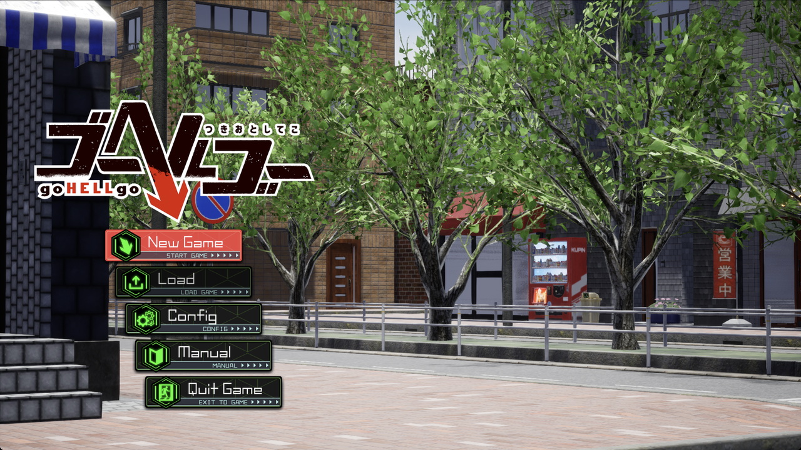
</p>

# Go Hell Go English Patch

**A free, unofficial English fan translation for goHELLgo Tsukiotoshiteko** (ゴーヘルゴー つきおとしてこ), the Windows PC version.

**Version 0.0.1 beta** · [Download](../../releases/latest) · [Report a translation mistake](../../issues/new?template=translation-fix.yml) · [Report a bug](../../issues/new?template=bug-report.yml)

> [!IMPORTANT]
> **You need a full copy of the game.** This patch is not the game and does not contain it. It only works with a legitimately purchased PC copy of goHELLgo Tsukiotoshiteko that is already installed. Please buy the game to support its creators.

> [!WARNING]
> **This is a machine translation.** Expect some odd or wrong lines. Corrections are welcome: see [Fixing the translation](#fixing-the-translation).

> [!CAUTION]
> **This patch is still being tested.** Play-testing hasn't reached the end of the first part of the game yet, so most of the game hasn't been checked in-game. If something needs fixing, please fill out a [Translation fix request](../../issues/new?template=translation-fix.yml) or a [Bug report](../../issues/new?template=bug-report.yml) on GitHub, and it will be fixed in a later version.

> [!NOTE]
> **The patch is 100% free and always will be.** If you paid for it, you were scammed. The only official download is on this page.

## Contents

- [What the patch changes](#what-the-patch-changes)
- [Screenshots](#screenshots)
- [Requirements](#requirements)
- [Install on Windows](#install-on-windows)
- [Install on Mac (CrossOver)](#install-on-mac-crossover)
- [Install on Linux (Wine)](#install-on-linux-wine)
- [Uninstall: back to Japanese](#uninstall-back-to-japanese)
- [Fixing the translation](#fixing-the-translation)
- [Known issues](#known-issues)
- [FAQ](#faq)
- [License](#license)

## What the patch changes

About 18,800 pieces of text and a few images:

- **The whole story:** all 13,425 lines of dialogue in the main story, Hell scenes, staff episodes and side scenes, plus every speaker name.
- **Menus and tutorials:** buttons, screen titles, help text and tutorial pages.
- **Game data:** items, skills, enemies, Hells and their passives, work areas, the souls' names and descriptions, and the shop.
- **Images:** the 26 chapter title cards, redrawn in English.
- **The manual:** the in-game manual, plus an English copy of the game's HTML manual, which is installed in a `Manual (English)` folder.
- **Menus:** some labels are shortened, and some fonts are resized, so the English fits its boxes.

Names stay Japanese, and honorifics such as -chan and -san are kept. Nothing is censored: the translation keeps the original's crude humor, violence and mature content.

## Screenshots

| | |
|:-:|:-:|
| 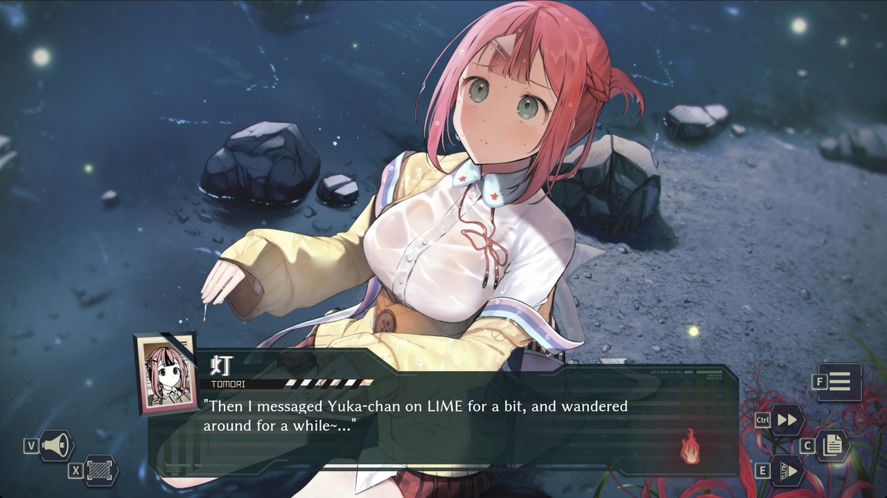 | 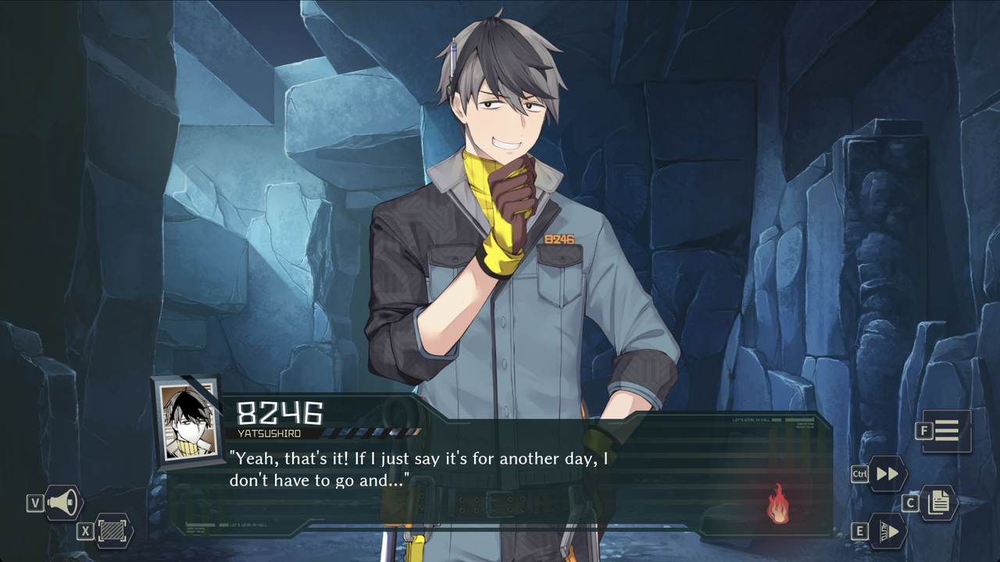 |
| Story scenes | |
| 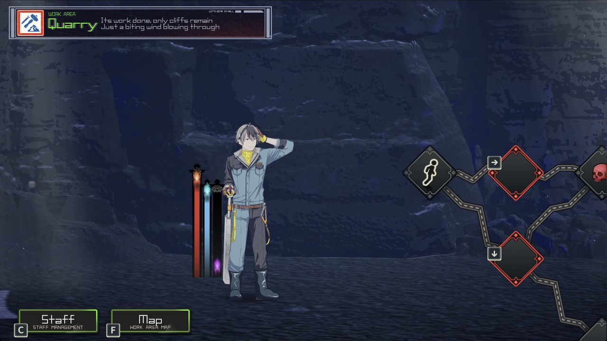 | 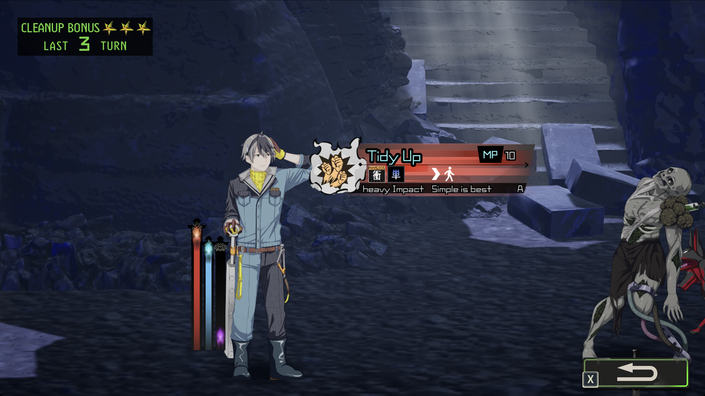 |
| Work areas | Battles |
| 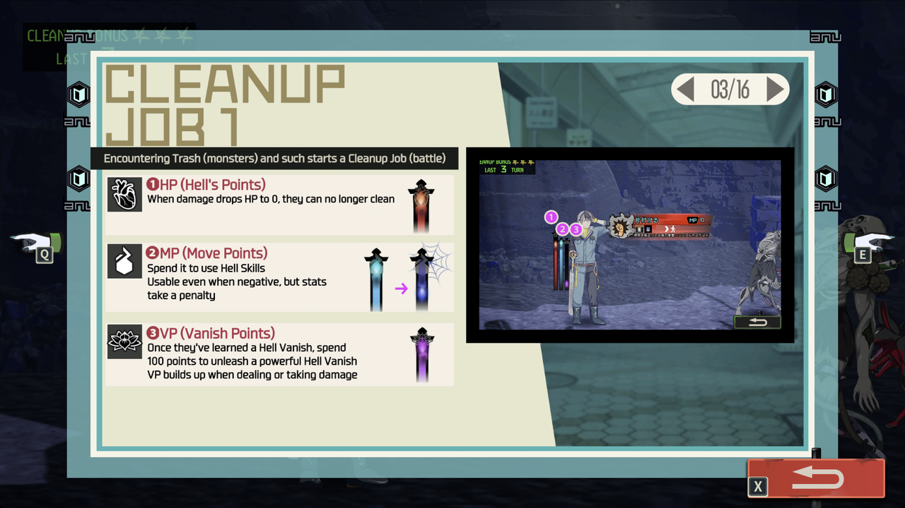 | 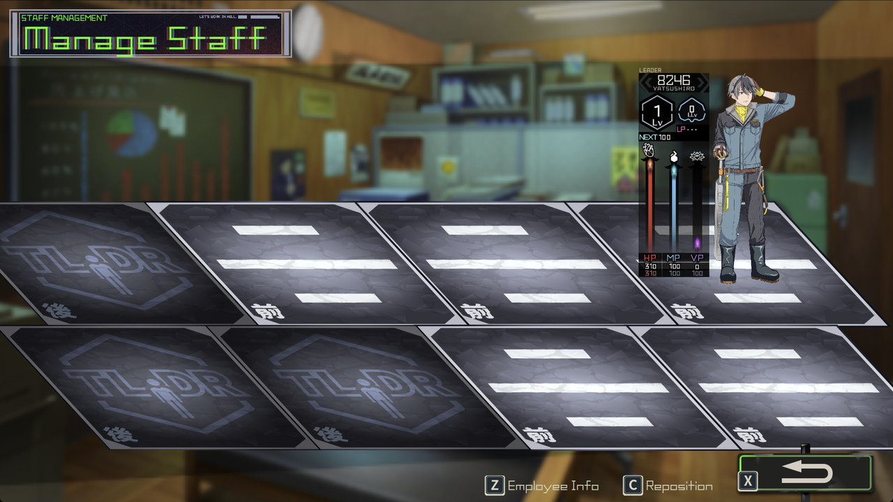 |
| Tutorials | Menus |
| 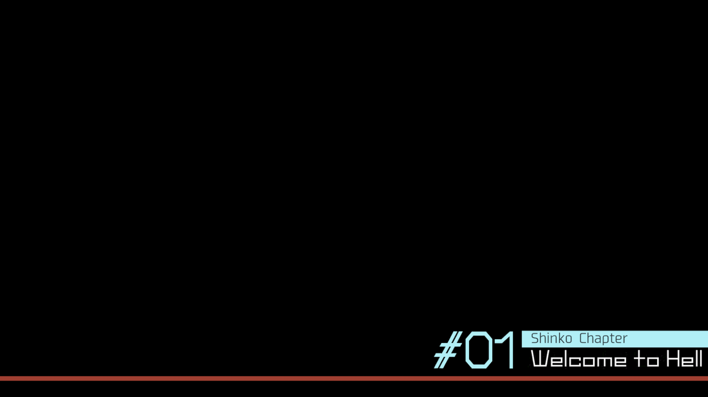 |  |
| Chapter title cards | Title screen |

## Requirements

- **A full, installed copy of goHELLgo Tsukiotoshiteko for Windows PC** (the Japanese release).
  - The patch was made for the copy whose main data file, `gohellgo\Content\Paks\gohellgo-WindowsNoEditor.pak`, is 1,883,989,889 bytes.
  - Other editions or game updates may differ. The installer checks your copy first and stops without changing anything if it doesn't match. If that happens, please [report it](../../issues/new?template=bug-report.yml) and say where you bought the game.
- **One of:**
  - Windows 10 or 11.
  - A Mac with [CrossOver](https://www.codeweavers.com/crossover). This was tested with CrossOver 26.
  - Linux with Wine. This should work but is untested.
- About 70 MB of free space.

## Install on Windows

**1. Download** `GoHellGo-English-Setup-0.0.1-beta.exe` from the [Releases page](../../releases/latest).

**2. Put the setup file in the game folder**, the folder that contains `gohellgo.exe`, and double-click it.

<p align="center">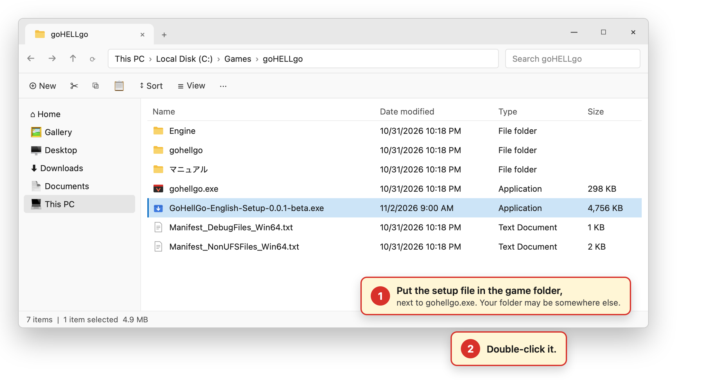</p>

**3. Allow it to run.** The installer isn't code-signed (a certificate costs money, and this project is free), so Windows may warn you:
- **"Windows protected your PC"**: click **More info**, then **Run anyway**.
- **"Do you want to allow this app to make changes?"**: click **Yes**. It needs this to write into the game folder.

**4. Click Next.** The installer finds the game by itself and shows where. If the setup file is somewhere else, it asks you to choose the game folder instead.

<p align="center">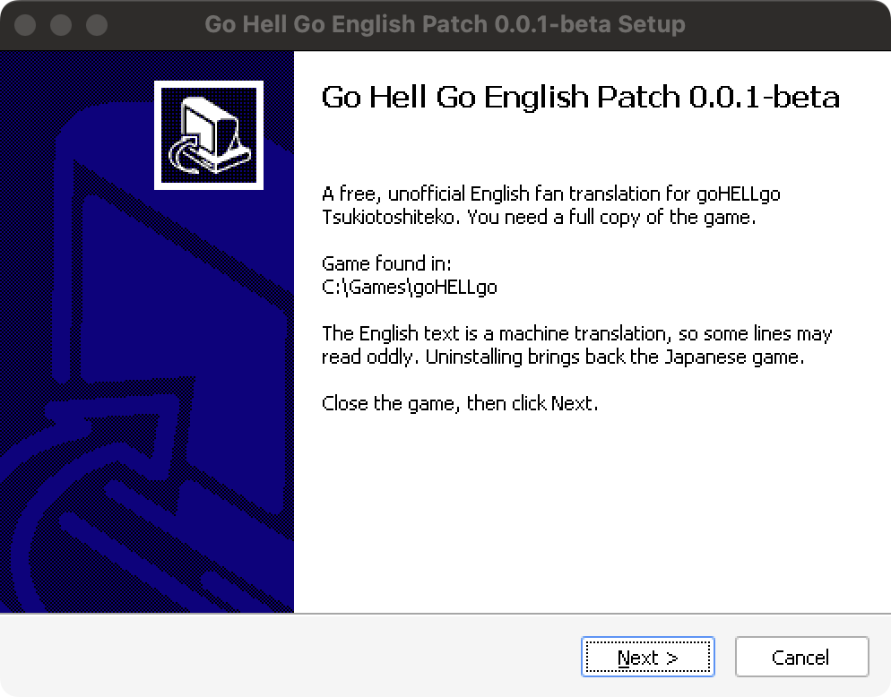</p>

**5. Read the license and click I Agree.** The patch installs in a few seconds.

<p align="center">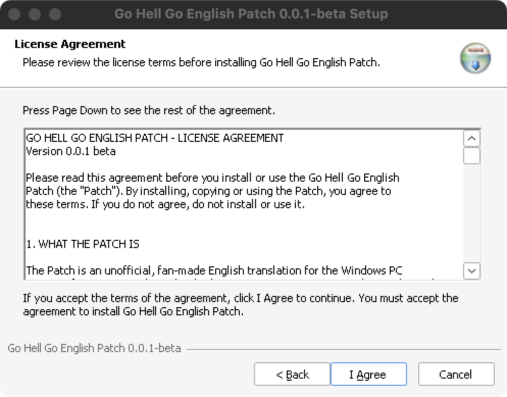</p>

**6. Click Finish.** Start the game the way you usually do. It's now in English.

<p align="center">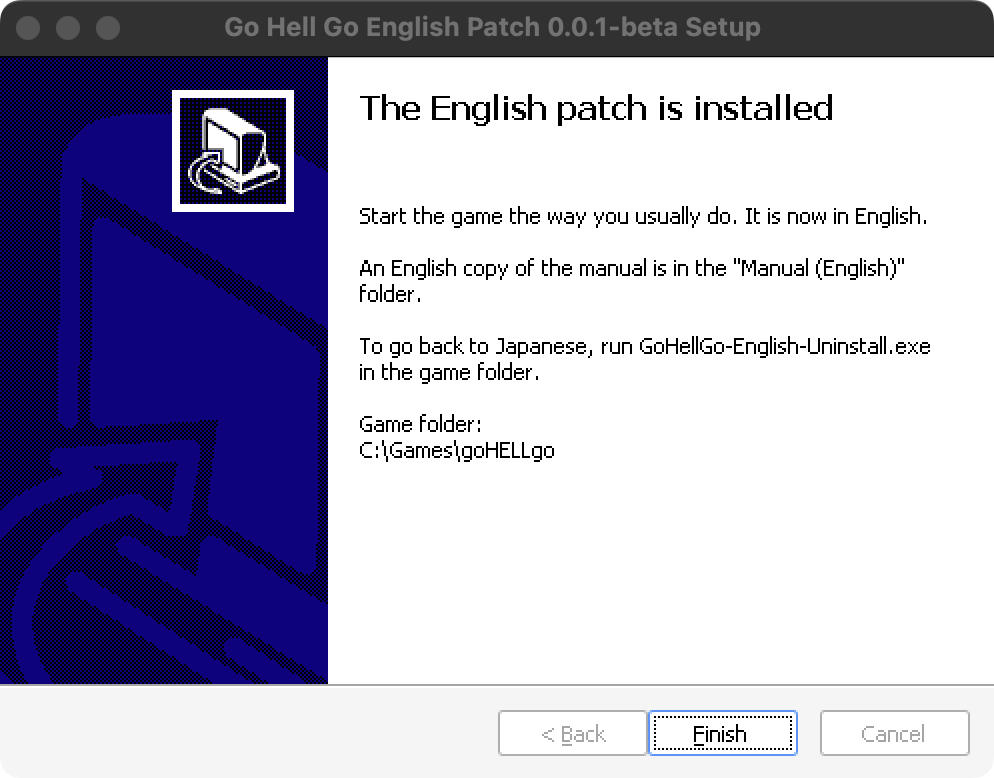</p>

To update to a newer version later, run the newer setup file the same way. You don't need to uninstall first.

## Install on Mac (CrossOver)

The setup file is a Windows program, so it runs inside **the same CrossOver bottle as the game**.

**1. Download** `GoHellGo-English-Setup-0.0.1-beta.exe` from the [Releases page](../../releases/latest).

**2. Copy it into the game folder inside the bottle.** In CrossOver, select the bottle the game is installed in and click **Open C: Drive**. Open the game folder, the one that contains `gohellgo.exe`, and copy the setup file into it.

<p align="center">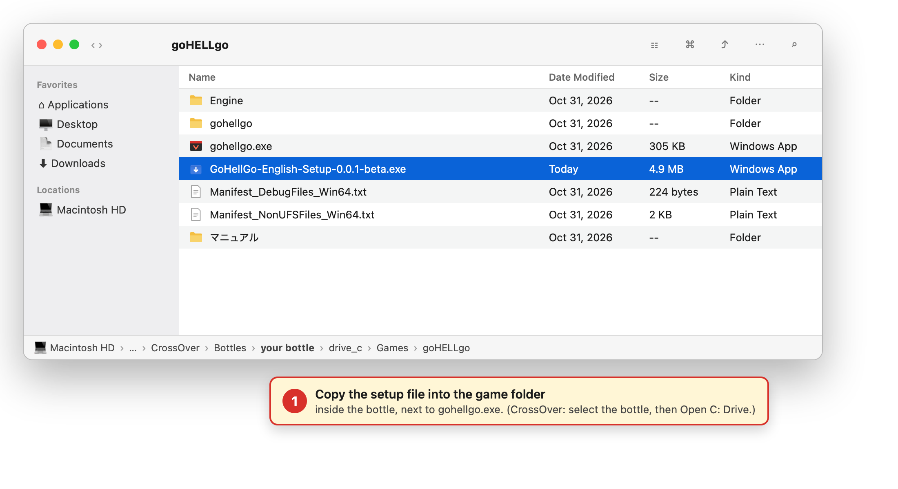</p>

**3. Run it in that bottle.** In CrossOver, with the game's bottle selected, click **Run Command**, then **Browse…**, choose the setup file, and click **Run**. Or drag the setup file onto the bottle in CrossOver's sidebar, then click **Run**.

<p align="center">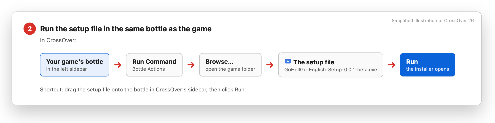</p>

**4. Finish the installer** as in steps 4 to 6 for Windows above. It looks the same. Then start the game from CrossOver as usual.

## Install on Linux (Wine)

This is untested, but it's the same idea: put the setup file in the game folder and run it with the **same Wine prefix** the game uses:

```sh
WINEPREFIX=/path/to/your/prefix wine "/path/to/game/GoHellGo-English-Setup-0.0.1-beta.exe"
```

In Lutris, select the game, then choose **Wine options → Run EXE inside Wine prefix**. If you try it, please let us know how it went with a [bug report](../../issues/new?template=bug-report.yml), even if it worked.

## Uninstall: back to Japanese

- Run `GoHellGo-English-Uninstall.exe` in the game folder. On a Mac, run it with **Run Command** as in step 3 above.
- On Windows, you can also go to **Settings → Apps → Installed apps → Go Hell Go English Patch → Uninstall**.

The patch never changes the game's own files. It only adds a few files next to them: the English data file `gohellgo-English_P.pak`, the `Manual (English)` folder and the uninstaller. Uninstalling deletes exactly those, and the game is back to the Japanese original.

The patch never touches your save files. Back up your saves before installing anyway: this is a beta.

## Fixing the translation

The project is actively maintained, and corrections from players are how the machine translation gets better.

To suggest a fix, open a **[Translation fix request](../../issues/new?template=translation-fix.yml)**. You need a free GitHub account. Every request must give four things:

1. **Chapter:** where the line appears, such as "#03 Boss Stage", or menus/items if it's not in the story.
2. **Line:** the line copied exactly as it reads in the game. Include the speaker if there is one.
3. **Change:** what it should say instead.
4. **Reason:** why, for example a mistranslation, the wrong name, the wrong tone, a typo, or a line that doesn't fit its box.

Requests missing any of the four may be closed. A screenshot and the original Japanese help but are optional. The [contributing guide](CONTRIBUTING.md) has more detail.

For crashes, installer problems or text running out of its box, use a **[Bug report](../../issues/new?template=bug-report.yml)** instead.

## Known issues

- **Some Japanese is drawn into pictures and isn't translated yet:**
  - the small item tags (清掃用, 従業員用);
  - the attribute icons in battle and on skills (衝, 熱 and others);
  - the 前/後 (front/back) marks on the staff formation screen;
  - the screenshots inside the tutorial pages, which show the original Japanese menus.

  All the text around them is in English.
- **Speaker name plates** show the character's name in kanji, with the game's own romaji under it, for example 灯 / TOMORI.
- A few tutorial lines still say "Employee Management", while the button it describes now reads "Staff".
- It's a machine translation, so some lines will be wrong or stiff. Please [report them](../../issues/new?template=translation-fix.yml).

## FAQ

**Is this official?** No. It's an unofficial fan project, not affiliated with or endorsed by Entergram or the game's developers.

**Does it work with the Switch or PS4 version?** No, only the Windows PC version.

**My antivirus complains about the setup file.** Unsigned installers made with NSIS, the free tool this project uses, are sometimes flagged by mistake. Each release lists the file's SHA-256 checksum so you can check that your download is the official one. The code that builds the patch is in this repository.

**Is anything censored?** No. The translation follows the original script, including its crude, sexual and violent content.

**Will it always be free?** Yes.

## License

See [LICENSE](LICENSE). The installer also shows it, and you must accept it before installing. In short:

- The patch is free. Nobody may sell it.
- It requires your own full copy of the game.
- It is a machine translation.
- It comes with **no warranty** of any kind.
- It is not affiliated with the game's rights holders. All rights to the game belong to them.

Maintainers: see [docs/MAINTAINING.md](docs/MAINTAINING.md).
# goHellgo-English
